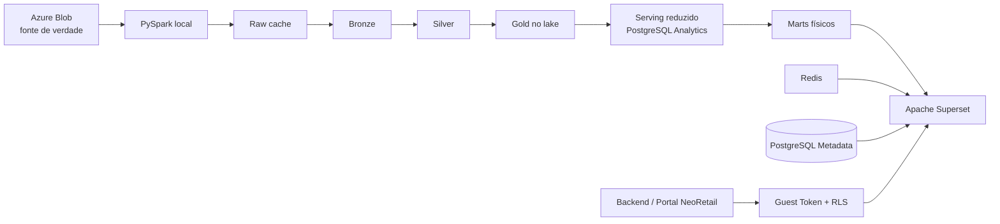
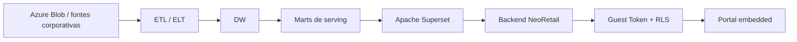

# NeoRetail V9 — Superset Embedded / AMBEV POC

POC do NeoRetail usando Apache Superset como camada analítica embedded, com
isolamento por indústria via `id_customer`, Guest Token e RLS.

A POC atual está focada na **AMBEV (`id_customer = 142`)** e tem dois objetivos:

1. reproduzir as principais experiências analíticas hoje usadas no produto;
2. medir se o Superset consegue entregar essas experiências com boa performance,
   baixo consumo de infraestrutura e integração simples com o NeoRetail.

> **Importante:** o PostgreSQL Analytics usado localmente não representa a
> arquitetura final de produção. Ele funciona como um **simulador do serving
> layer do DW** para desenvolvimento, validação funcional e benchmark.

---

## Estado atual

| Capacidade | Estado |
|---|---|
| Pipeline AMBEV a partir do Azure Blob | em funcionamento na POC |
| Bronze / Silver / Gold locais | implementado |
| Serving analítico em PostgreSQL local | implementado |
| RLS por `id_customer` | implementado |
| Portal embedded com Guest Token | implementado |
| Visão Geral — Indústria | implementado |
| Panorama — Indústria | implementado |
| Panorama — OSA | implementado |
| Tarefas do dia / Otimização de estoque | implementado |
| Exportação — Histórico dia | implementado |
| Exportação — Histórico mês | implementado |
| Benchmark de CPU/RAM do Superset | iniciado |
| Teste de 5–10 usuários simultâneos | pendente |
| Benchmark com DW real | pendente |
| Certificação formal das métricas pelo negócio | pendente |

Dashboard renderizado e query executada sem erro não significam que a métrica
foi certificada pelo negócio. A POC separa **validação técnica** de
**homologação funcional**.

---

## Arquitetura da POC local



O PostgreSQL local recebe somente o necessário para servir os dashboards da
POC. Fatos muito grandes podem permanecer completos no lake enquanto apenas uma
janela, projeção ou agregação é publicada no PostgreSQL.

Esse comportamento é intencional: a POC deve testar o **Superset como camada de
BI**, e não transformar o notebook local em um DW de produção.

---

## Arquitetura alvo

Na produção, o trabalho pesado deve ficar no **DW**. O Superset deve consultar
marts e agregações preparados para uso interativo.



A responsabilidade esperada fica dividida assim:

```text
armazenamento e processamento pesado
    -> DW

agregações e serving analítico
    -> marts no DW

consultas, visualização e interação
    -> Superset

identidade, autorização e experiência de produto
    -> Backend NeoRetail + Embedded
```

Isso significa que aumentar o volume bruto da AMBEV não implica,
necessariamente, aumentar na mesma proporção a RAM do Superset. Se o DW entrega
resultados agregados pequenos, o maior impacto de volume tende a acontecer no
compute do DW, não na camada de apresentação.

---

## Isolamento por indústria

O isolamento não depende dos filtros visíveis do dashboard.

1. o usuário entra no portal NeoRetail;
2. o backend identifica as indústrias autorizadas;
3. o dashboard selecionado é validado pelo catálogo;
4. o backend gera um Guest Token;
5. o token recebe uma cláusula RLS como `id_customer = 142`;
6. o Superset aplica o RLS antes de executar as consultas.

Os filtros nativos refinam a análise, mas **não substituem o RLS**.

---

## Tenant da POC

| `id_customer` | Cliente | Origem principal |
|---:|---|---|
| 142 | AMBEV | `FATO/CUSTOMER/DAILY/NM_CUSTOMER=AMBEV` |

O catálogo embedded atual está configurado somente para AMBEV.

Arquivo de cadastro:
- `config/customers.yaml`

Catálogo, módulos e permissões:
- `config/tenants.yaml`

---

## Dashboards embedded

O catálogo atual publica seis experiências:

| Chave | Dashboard | Menu |
|---|---|---|
| `overview` | Visão geral — Indústria | Visão geral / Indústria |
| `panorama` | Panorama — Indústria | Panorama / Geral |
| `osa` | Panorama — OSA | Panorama / OSA |
| `tasks` | Tarefas do dia — Pré-ruptura / Excesso | Tarefas do dia |
| `export_daily` | Exportação — Histórico dia | Exportação / Histórico dia |
| `export_monthly` | Exportação — Histórico mês | Exportação / Histórico mês |

Navegação do portal:

```text
Visão geral
└── Indústria

Panorama
├── Geral
└── OSA

Tarefas do dia
└── Pré-ruptura / Excesso

Exportação
├── Histórico dia
└── Histórico mês
```

---

## Serving marts

Os dashboards não devem fazer joins pesados diretamente durante a interação.
Por isso, a POC cria marts físicos no PostgreSQL.

### Base de serving

`analytics-db/marts/30_neoretail_serving_marts.sql`

- `gold.nr_overview_history`
- `gold.nr_panorama_latest`
- `gold.nr_panorama_weekly`
- `gold.nr_panorama_opportunities`
- `gold.nr_tvd_daily`
- `gold.nr_panorama_opportunities_latest`
- `gold.nr_osa_industry_causes`
- `gold.nr_stock_tasks`

### Performance da Visão Geral

`analytics-db/marts/31_overview_performance.sql`

- `gold.nr_overview_summary`
- `gold.nr_ivd_daily`

Esses marts decompõem métricas pesadas em componentes aditivos e reduzem o
trabalho executado durante a interação.

### Exportação

`analytics-db/marts/32_export_serving.sql`

- `gold.nr_export_daily`
- `gold.nr_export_monthly`

A exportação diária não replica a `fato_diaria` inteira no PostgreSQL.
A tabela completa permanece no lake e uma fonte reduzida é publicada para o
serving:

- `gold.nr_export_daily_source`

### Serving interativo e filtros

Os lotes `34` a `37` adicionam caminhos compactos para a interação padrão sem
remover as marts detalhadas usadas quando há filtros dimensionais:

- `gold.nr_filter_options`: opções de localização, produto, atividade e unidade;
- `gold.nr_tvd_daily_summary` e `gold.nr_ivd_daily_summary`: totais por tenant/dia;
- `gold.nr_panorama_weekly_summary`: componentes aditivos por tenant/semana;
- `gold.nr_overview_distinct_summary`: cardinalidades exatas por tenant/mês;
- `gold.nr_osa_causes_summary`: perda OSA por tenant/mês/motivo/causa.

Os datasets virtuais escolhem a fonte compacta quando não existe filtro de
negócio. Ao selecionar rede, loja, produto ou outra dimensão compatível, a
consulta volta automaticamente à mart detalhada. `id_customer` continua em
todas as fontes e o RLS/Guest Token permanece independente dessa seleção.

Por padrão, essa fonte usa uma janela recente e somente as colunas necessárias
à exportação.

---

## Exportação

A área de Exportação possui duas páginas:

```text
Histórico dia
Histórico mês
```

Cada uma possui quatro visões:

```text
Varejo
Produto
Geral
Resumo
```

Filtros disponíveis incluem:

- Rede e Bandeira;
- UF e Cidade;
- Tipo local e Loja;
- Nível de atividade;
- Marca;
- Hierarquias 1, 2 e 3;
- Item;
- Unidade de medida;
- Indicador;
- Ano, Mês e, no histórico diário, Dia.

Indicadores atualmente disponíveis:

- Venda;
- Cobertura estoque;
- Estoque;
- Estoque em Trânsito;
- ISV (%);
- OSA (%);
- Perda OSA vol.;
- Perda OSA R$;
- Preço médio (R$).

O limite visual de exportação é de **100.000 registros por vez**. O usuário deve
usar filtros quando precisar reduzir o volume antes do download.

---

## Tarefas do dia / Otimização de estoque

A tela de tarefas contém:

```text
Pré-ruptura
Excesso
Otimização de estoque
```

A página usa marts de serving dedicados para evitar consultas pesadas contra os
fatos brutos durante a navegação.

Os cards superiores de TVD/IVD, rankings e tabelas de incidência devem ser
validados separadamente quanto a regra de negócio e performance.

---

## Atualização do serving

Depois de publicar ou atualizar a Gold:

```powershell
.\create-superset-kpi-views.ps1
```

Esse comando aplica os SQLs versionados da camada de serving e executa
`ANALYZE` após a criação dos objetos.

Para atualizar somente a fonte PostgreSQL usada pela exportação diária:

```powershell
docker compose exec -T local-engine python -m neoretail_local.gold_serving --customer 142 --export-daily-only
```

---

## Bootstraps do Superset

```powershell
docker compose exec -T superset /app/.venv/bin/python /app/pythonpath/bootstrap_overview.py
docker compose exec -T superset /app/.venv/bin/python /app/pythonpath/bootstrap_panorama.py
docker compose exec -T superset /app/.venv/bin/python /app/pythonpath/bootstrap_osa_industry.py
docker compose exec -T superset /app/.venv/bin/python /app/pythonpath/bootstrap_stock_optimization.py
docker compose exec -T superset /app/.venv/bin/python /app/pythonpath/bootstrap_export.py
docker compose exec -T superset /app/.venv/bin/python /app/pythonpath/bootstrap_embedded.py
```

Os scripts são idempotentes: podem ser executados novamente para atualizar
datasets, charts e layouts existentes.

---

## Performance

A estratégia principal de performance da POC é:

```text
fato grande
   ↓
transformação / agregação no refresh
   ↓
mart físico
   ↓
consulta pequena no Superset
```

### Evidências já observadas

Em benchmarks históricos da POC, a substituição de consultas virtuais por marts
físicos reduziu significativamente o tempo de execução de consultas
representativas. Esses resultados foram obtidos em ambiente local e não devem
ser tratados como SLA de produção.

Medição cold-cache local de 18/09/2026, executada pelo mecanismo de consulta do
Superset para `id_customer = 142`:

| Consulta | Antes | Depois |
|---|---:|---:|
| Exportação mês — Produto | 25,31 s | 1,08 s |
| Exportação mês — Varejo | 10,40 s | 1,19 s |
| Exportação dia — Produto | 6,80 s | 2,55 s |
| Exportação dia — Varejo | 14,29 s | 0,39 s |
| TVD — Visão geral | 25,11 s na rodada de diagnóstico | 0,38 s |
| IVD — Visão geral | 44,73 s na rodada de diagnóstico | 0,14 s |
| Panorama vendas semanal | 4,80 s | 0,77 s |
| Panorama estoque semanal | 2,49 s | 0,15 s |
| Panorama Giro/ROI semanal | 2,26 s | 0,15 s |
| Panorama OSA semanal | 2,04 s | 0,13 s |
| Distribuição e sortimento | 5,48 s | 0,29 s |
| OSA — Perdas | 2,14 s | 0,61 s |

As listas dos filtros, antes medidas em até 3,10 s sobre marts com cerca de 14
milhões de linhas, ficaram entre 0,004 s e 0,218 s sobre `nr_filter_options`.
Os resultados completos, a reconciliação numérica e as limitações estão em
[`docs/performance_audit.md`](docs/performance_audit.md).

O profiler aceita recorte por dashboard e por trecho do nome do gráfico:

```powershell
.\profile-performance.ps1 -ColdCache
.\profile-performance.ps1 -ColdCache `
  -Dashboard neoretail-v9-panorama-industria `
  -Chart semanal
```

### Snapshot atual do container Superset

Medição manual no ambiente local:

```text
CPU:       3,58%
RAM:       878,1 MiB
Limite:    15,47 GiB
PIDs:      99
```

Esse número é apenas uma **baseline com carga baixa**. Ele não representa o
consumo com usuários simultâneos nem substitui um teste de carga.

---

## Teste de concorrência

O benchmark de concorrência do backend está disponível em
[`docs/load_testing.md`](docs/load_testing.md).

Meta atual da POC:

```text
1 usuário   -> baseline
5 usuários  -> carga intermediária
10 usuários -> cenário de pico esperado
15 usuários -> stress test opcional
```

Durante o teste são registrados separadamente:

- CPU e RAM do Superset;
- CPU e RAM do PostgreSQL Analytics;
- Redis;
- embedded-app;
- tempo médio;
- p50;
- p95;
- taxa de erro;
- comportamento de filtros;
- download de exportação.

Execução reproduzível:

```powershell
.\load-test-users.ps1 -Users 1,5,10 `
  -Dashboard "neoretail-v9-visao-geral-industria" -ColdCache
```

Na medição local, a configuração válida com até 12 consultas simultâneas teve
0% de erros para 1, 5 e 10 usuários. A RAM do Superset permaneceu próxima de
1,04–1,07 GiB, mas o PostgreSQL Analytics atingiu aproximadamente 1.495% de CPU
e o page p95 chegou a 50,98 s na Visão Geral e 77,34 s no Panorama para dez
aberturas frias simultâneas. O primeiro gargalo observado foi o serving local e
o fan-out de charts.

Uma segunda suíte E2E/HTTP ainda deve simular fluxos reais, por exemplo:

```text
login
-> Guest Token
-> Visão Geral
-> filtros
-> Panorama
-> Tarefas
-> Exportação
-> download
```

O teste atual executa `QueryContext` internamente e não mede HTTP, Gunicorn,
Guest Token ou navegador. O sizing de produção só deve ser fechado depois do
teste E2E e da repetição contra o DW real.

---

## Interpretação correta do benchmark

Existem dois custos diferentes:

### 1. Custo da camada Superset

- workers;
- CPU;
- RAM;
- sessões;
- Guest Token;
- renderização;
- concorrência.

### 2. Custo da camada de dados

- volume da AMBEV;
- scan;
- joins;
- agregações;
- concorrência no DW;
- cache;
- warehouse/compute.

O PostgreSQL local ajuda a medir a POC, mas **não substitui o benchmark do DW
real**. O teste final deve separar esses dois componentes.

---

## Serviços locais

| Serviço | Finalidade | Acesso padrão |
|---|---|---|
| `superset-db` | metadados do Superset | interno |
| `analytics-db` | serving analítico local | `localhost:5433` |
| `redis` | cache / suporte ao Superset | interno |
| `superset-init` | migrações e setup | one-shot |
| `superset` | dashboards e API | <http://localhost:8088> |
| `local-engine` | PySpark / pipeline / Jupyter | <http://localhost:8888> |
| `embedded-app` | portal NeoRetail | <http://localhost:3000> |
| `blob-profiler` | profiling opcional do Blob | profile `blob` |

---

## Início rápido

Windows:

```powershell
Copy-Item .env.example .env
.\start.ps1 -Rebuild
```

Execuções seguintes, quando não houver mudança de imagem/frontend:

```powershell
.\start.ps1
```

Credenciais locais padrão do Superset:

```text
usuário: admin
senha:   admin
```

Essas credenciais são apenas para desenvolvimento local.

---

## Pipeline de dados

Exemplo:

```powershell
.\run-local-pipeline.ps1 -Step 02A -Customer 142
```

Etapas principais:

| Etapa | Responsabilidade |
|---|---|
| `00` | setup local |
| `01` | descoberta do Blob |
| `02A` | Bronze de dimensões |
| `02B` | candidatos de fatos |
| `03A` | Silver de dimensões |
| `03B` | Silver de fatos |
| `03C` | oportunidades |
| `03D` | validação de paridade |
| `04` | aprovação de fatos |
| `05` | Gold de dimensões / PostgreSQL |
| `06` | Gold de fatos / serving |
| `07` | prontidão de métricas |
| `08` | quality gate final |

A Gold lake preserva o dado aprovado. O PostgreSQL pode receber somente o
recorte necessário para a POC.

---

## Portal embedded

O portal em <http://localhost:3000> consome `config/tenants.yaml` para montar o
catálogo de dashboards autorizados.

Fluxo simplificado:

```text
usuário
  ↓
portal
  ↓
catálogo autorizado
  ↓
Guest Token
  ↓
RLS id_customer
  ↓
Superset embedded
```

O frontend administrativo do Superset não precisa ser exposto ao usuário final.

---

## Validação

Estrutura e sintaxe:

```powershell
.\validate.ps1
```

Saúde:

```powershell
.\health.ps1
.\status.ps1
```

Validação de dashboards:

```powershell
docker compose exec -T superset /app/.venv/bin/python /app/pythonpath/validate_overview.py
docker compose exec -T superset /app/.venv/bin/python /app/pythonpath/validate_panorama.py
docker compose exec -T superset /app/.venv/bin/python /app/pythonpath/validate_osa_industry.py
docker compose exec -T superset /app/.venv/bin/python /app/pythonpath/validate_stock_optimization.py
```

---

## Princípios da POC

1. **não usar o Superset como engine de transformação pesada;**
2. **não replicar fatos gigantes no PostgreSQL local sem necessidade;**
3. **materializar cálculos caros antes da interação;**
4. **manter RLS independente dos filtros visíveis;**
5. **preservar `id_customer` em todos os objetos de serving;**
6. **medir antes de dimensionar infraestrutura;**
7. **não extrapolar benchmark local como sizing de produção;**
8. **não alterar regra de negócio apenas para facilitar a visualização.**

---

## O que ainda falta provar

Antes de qualquer decisão de produção, ainda é necessário:

- benchmark com 5–10 usuários simultâneos;
- medição de p50/p95 e erros;
- teste com volume representativo;
- benchmark conectado ao DW real;
- custo por workload / tela;
- homologação das métricas pelo negócio;
- observabilidade e alertas;
- desenho de DEV / HML / PROD;
- estratégia de backup do metadata database;
- CI/CD e rollback.

---

## Estrutura do repositório

```text
analytics-db/       marts e objetos de serving
blob-profiler/      profiling das fontes
config/             clientes, tenants e contratos
docs/               arquitetura e documentação
embedded-app/       portal embedded
local-engine/       pipeline PySpark
scripts/            validações
superset/           configuração, plugin e bootstraps
generated/          artefatos locais
certs/              certificados locais
```

---

## Segurança

- não versione `.env`, SAS, senhas ou tokens;
- Guest Token + RLS é a fronteira de autorização analítica;
- filtros nativos são apenas filtros de navegação;
- toda query multitenant deve preservar `id_customer`;
- mudanças em marts devem ser revisadas antes da aplicação;
- credenciais padrão são somente para localhost.

---

## Resumo da proposta

A POC não tenta provar que o PostgreSQL local substitui o DW.

Ela tenta provar que:

> **com uma camada de serving adequada no DW, o Superset consegue funcionar
> como camada embedded do NeoRetail com isolamento, paridade funcional,
> performance aceitável e custo de infraestrutura mensurável.**

A etapa de backend/query com até **10 usuários simultâneos** foi concluída. A
próxima evidência é o benchmark **E2E/HTTP** e, depois, a validação sobre o
**DW real**.
