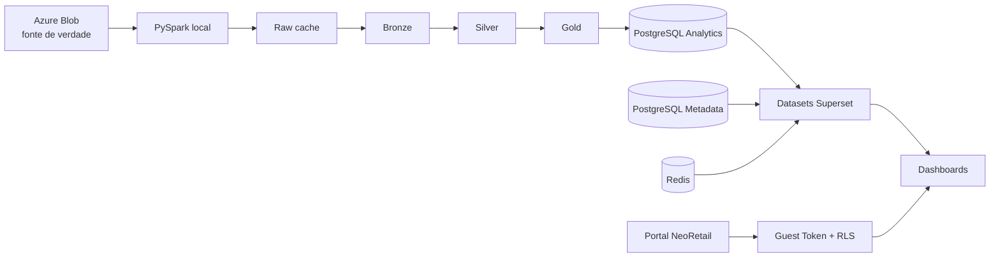

# NeoRetail V9 — Superset multitenant

POC local da plataforma analítica NeoRetail com ingestão a partir do Azure Blob,
pipeline PySpark em camadas, PostgreSQL para serving, Apache Superset 6 com
visuais próprios e portal embedded com isolamento por indústria.

O projeto preserva a estrutura funcional da V8.1 e acrescenta o modelo
multitenant da V9. Toda dimensão e fato publicada na Gold carrega
`id_customer`, que também é a chave usada pelo RLS do Superset.

## O que está incluído

- descoberta e leitura de Parquets no Azure Blob;
- lake local em Raw cache, Bronze, Silver e Gold;
- normalização tolerante a schema drift e rastreabilidade da origem;
- quality gates para Silver, Gold e prontidão de métricas;
- PostgreSQL Analytics separado do banco de metadados do Superset;
- dashboards reproduzíveis de Visão Geral, Panorama e OSA da Indústria;
- plugin React `NeoRetail KPI Card` integrado ao frontend do Superset;
- portal embedded com Guest Token e RLS por `id_customer`;
- scripts de inicialização, atualização, saúde, validação e reset.

## Arquitetura



O Azure Blob continua sendo a fonte de verdade. O lake e o PostgreSQL locais
são materializações para desenvolvimento e validação. Na arquitetura alvo, o
Databricks substitui o PySpark e o serving local sem mudar o contrato
multitenant baseado em `id_customer`.

### Isolamento por cliente

1. O usuário entra no portal NeoRetail.
2. O backend lê os clientes permitidos em `config/tenants.yaml`.
3. O usuário seleciona uma indústria autorizada.
4. O backend solicita ao Superset um Guest Token com uma cláusula como
   `id_customer = 259`.
5. O Superset aplica o RLS antes de calcular métricas e renderizar os gráficos.

Os filtros visíveis refinam a análise. Eles não substituem o RLS e não devem
ser usados como fronteira de segurança.

## Clientes iniciais

| `id_customer` | Cliente | Prefixo no Blob |
|---:|---|---|
| 259 | 3 Corações | `PARTICULAR_3/3CORACOES` |
| 609 | Baston | `PARTICULAR_3/BASTON` |
| 16868 | Safira | `PARTICULAR_3/SAFIRA` |

O cadastro corporativo fica em [`config/customers.yaml`](config/customers.yaml).
As permissões da POC embedded ficam em
[`config/tenants.yaml`](config/tenants.yaml). O pipeline valida o nome e o ID
contra `DIMENSAO_CUSTOMER` antes de publicar a Silver.

## Serviços locais

| Serviço | Finalidade | Acesso padrão |
|---|---|---|
| `superset-db` | Metadados, usuários, datasets, charts e dashboards | interno |
| `analytics-db` | Schemas `bronze`, `silver`, `gold` e `audit` | `localhost:5433` |
| `redis` | Cache e suporte ao Superset | interno |
| `superset-init` | Migrações, administrador e conexão Analytics | job one-shot |
| `superset` | Exploração e dashboards | <http://localhost:8088> |
| `local-engine` | PySpark, pipeline e Jupyter | <http://localhost:8888> |
| `embedded-app` | Portal multitenant demonstrativo | <http://localhost:3000> |
| `blob-profiler` | Perfil opcional das fontes no Blob | profile `blob` |

## Pré-requisitos

- Docker Desktop com Docker Compose v2;
- PowerShell 5.1 ou superior no Windows;
- pelo menos 8 GB de memória disponíveis para o Docker;
- acesso ao Azure Blob somente para executar o pipeline de dados;
- Git e Node.js apenas para desenvolvimento fora dos containers.

## Início rápido

No Windows:

```powershell
Copy-Item .env.example .env
.\start.ps1 -Rebuild
```

O parâmetro `-Rebuild` compila as imagens, inclusive o frontend customizado do
Superset. Nas execuções seguintes, quando o código das imagens não mudou:

```powershell
.\start.ps1
```

Em Linux ou macOS:

```bash
cp .env.example .env
./start.sh --build
```

O start funciona sem credencial do Blob. A ingestão permanece bloqueada até
que `AZURE_STORAGE_CONNECTION_STRING` seja preenchida no `.env`.

Credenciais locais padrão do Superset:

```text
usuário: admin
senha:   admin
```

Troque as credenciais e as chaves antes de usar o ambiente fora do localhost.

## Configuração

Copie [`.env.example`](.env.example) para `.env`. O arquivo `.env` não deve ser
versionado.

| Variável | Uso |
|---|---|
| `SUPERSET_SECRET_KEY` | assinatura interna do Superset |
| `GUEST_TOKEN_JWT_SECRET` | assinatura dos Guest Tokens |
| `SUPERSET_ADMIN_*` | usuário administrador local |
| `ANALYTICS_DB_*` | conexão com o PostgreSQL Analytics |
| `AZURE_STORAGE_CONNECTION_STRING` | acesso à fonte no Blob |
| `AZURE_STORAGE_CONTAINER` | container do Azure Storage |
| `NEORETAIL_CUSTOMER` | cliente padrão dos comandos locais |
| `LOCAL_LAKE_FORMAT` | `parquet` por padrão; `delta` é opcional |
| `SPARK_DRIVER_MEMORY` | memória do driver PySpark |
| `PUBLIC_SUPERSET_URL` | URL usada pelo portal embedded |
| `DEMO_USER_PASSWORD` | senha do usuário demonstrativo |

O valor padrão de `LOCAL_LAKE_FORMAT=parquet` evita baixar JARs do Maven.
O modo `delta` pode exigir acesso externo na primeira inicialização.

## Pipeline de dados

O comando principal executa uma etapa para um cliente por vez:

```powershell
.\run-local-pipeline.ps1 -Step 02A -Customer 259
```

O parâmetro `-Customer` aceita o ID ou o nome cadastrado. O resumo da execução
fica em `generated/local_pipeline_summary.json`.

| Etapa | Responsabilidade |
|---|---|
| `00` | prepara diretórios, schemas e configuração local |
| `01` | descobre e inventaria os arquivos do Blob |
| `02A` | carrega dimensões aprovadas na Bronze |
| `02B` | materializa fatos candidatos por família e varejista |
| `03A` | normaliza as dimensões na Silver |
| `03B` | consolida fatos com tratamento de schema drift |
| `03C` | estrutura oportunidades a partir do `ETL_CALC_V2` |
| `03D` | compara Bronze e Silver e grava o quality gate |
| `04` | verifica as famílias aprovadas para publicação |
| `05` | publica dimensões Gold no lake e no PostgreSQL |
| `06` | publica fatos Gold aprovados |
| `07` | registra a prontidão das métricas |
| `08` | executa o quality gate final da Gold |

Fluxo recomendado para o primeiro cliente:

```powershell
.\run-local-pipeline.ps1 -Step 02A -Customer 259
.\run-local-pipeline.ps1 -Step 02B -Customer 259
.\run-local-pipeline.ps1 -Step 03A -Customer 259
.\run-local-pipeline.ps1 -Step 03B -Customer 259
.\run-local-pipeline.ps1 -Step 03C -Customer 259
.\run-local-pipeline.ps1 -Step 03D -Customer 259
.\run-local-pipeline.ps1 -Step 04  -Customer 259
.\run-local-pipeline.ps1 -Step 05  -Customer 259
.\run-local-pipeline.ps1 -Step 06  -Customer 259
.\run-local-pipeline.ps1 -Step 07  -Customer 259
.\run-local-pipeline.ps1 -Step 08  -Customer 259
```

Para atualizar os três clientes:

```powershell
.\run-multitenant-refresh.ps1
```

`FATO_MERCADO` está fora do pipeline da POC. Mesmo que existam candidatos de
mercado antigos no lake local, as etapas Silver e de validação não os processam.

As etapas `04` e `06` retornam `blocked` enquanto
[`config/approved_facts.yaml`](config/approved_facts.yaml) não possuir fatos
aprovados. Esse resultado é uma proteção e não uma falha técnica.

### Particionamento e idempotência

- lake: `<camada>/<tabela>/id_customer=<ID>`;
- PostgreSQL: cada carga substitui somente as linhas do cliente processado;
- joins incluem `id_customer` junto à chave de item, local ou negócio;
- o cache não baixa novamente um Blob com o mesmo ETag;
- a Bronze preserva arquivo, varejista, família, status e horário de ingestão;
- a Gold recebe somente fatos registrados como aprovados.

## Superset e dashboards

O `superset-init` executa migrações, cria o administrador, sincroniza papéis e
cadastra a conexão `NeoRetail Gold - PostgreSQL Local`. Os dashboards são
criados por scripts idempotentes, que podem ser executados novamente para
atualizar charts e layouts existentes.

Se a Gold acabou de ser publicada ou atualizada, execute:

```powershell
.\create-superset-kpi-views.ps1
```

Esse comando aplica as views de `analytics-db/views` e recria os marts físicos
de `analytics-db/marts` no schema Gold. Os marts persistem os joins, recortes de
último período e janelas usados pelos dashboards e possuem índices iniciados por
`id_customer`, que também é a chave de RLS. Depois da carga, o comando executa
`ANALYZE` para o PostgreSQL escolher planos com estatísticas atualizadas.

Os scripts abaixo apontam o Superset para esses objetos físicos e escrevem
somente datasets, charts e layouts no banco de metadados do Superset.

```powershell
docker compose exec -T superset /app/.venv/bin/python /app/pythonpath/bootstrap_overview.py
docker compose exec -T superset /app/.venv/bin/python /app/pythonpath/bootstrap_panorama.py
docker compose exec -T superset /app/.venv/bin/python /app/pythonpath/bootstrap_osa_industry.py
docker compose exec -T superset /app/.venv/bin/python /app/pythonpath/bootstrap_stock_optimization.py
docker compose exec -T superset /app/.venv/bin/python /app/pythonpath/bootstrap_embedded.py
```

Os oito marts compartilhados são:

- `gold.nr_overview_history` e `gold.nr_panorama_latest`;
- `gold.nr_panorama_weekly`;
- `gold.nr_panorama_opportunities` e
  `gold.nr_panorama_opportunities_latest`;
- `gold.nr_tvd_daily`, pré-agregado para a série diária e alertas de TVD;
- `gold.nr_osa_industry_causes`;
- `gold.nr_stock_tasks`.

O refresh multitenant completo já chama `create-superset-kpi-views.ps1` depois
de atualizar os três clientes. Portanto, a camada física sempre é reconstruída
com o estado final da Gold:

```powershell
.\run-multitenant-refresh.ps1
```

| Dashboard | Slug | Conteúdo principal |
|---|---|---|
| NeoRetail V9 — Visão geral da indústria | `neoretail-v9-visao-geral-industria` | TVD, IVD, giro, vendas, estoque, ROI, markup e OSA |
| NeoRetail V9 — Panorama Indústria | `neoretail-v9-panorama-industria` | evolutivos, comparativos, rankings e análise detalhada |
| NeoRetail V9 — OSA Indústria | `neoretail-v9-osa-industria` | visão mensal, perdas por motivo/causa e rankings OSA |
| NeoRetail V9 — Tarefas de Otimização — Estoque | `neoretail-v9-tarefas-otimizacao-estoque` | tendências TVD/IVD, rankings e incidências de estoque |

Exemplo de URL:

```text
http://localhost:8088/superset/dashboard/neoretail-v9-osa-industria/
```

O Panorama usa abas do Superset para as alternâncias Mensal/Semanal,
Valor/Quantidade e Estoque/Giro/OSA/Falta e Excesso. A tela OSA usa as abas
Valor/Perdas, equivalentes aos bookmarks do Power BI. O cliente inicial desses
dois dashboards é 3 Corações (`id_customer = 259`).

### Filtros nativos

Os dashboards usam filtros horizontais sobre as dimensões disponíveis:

- indústria;
- rede e bandeira;
- UF e cidade;
- tipo de local e loja;
- nível de atividade;
- marca;
- hierarquias de item;
- item e período.

As dependências podem ser organizadas em cascata, por exemplo:
`rede → bandeira → UF → cidade → loja`.

## Plugin NeoRetail KPI Card

O plugin está em
[`superset/frontend-plugin/plugin-chart-neoretail-kpi`](superset/frontend-plugin/plugin-chart-neoretail-kpi)
e é registrado no `MainPreset` durante o build da imagem.

Ele suporta:

- área com MTD, mês anterior e média U3M;
- barras comparativas;
- cartões com vários indicadores;
- evolutivos combinando barras e linhas;
- rankings horizontais;
- colunas empilhadas;
- barras verticais por categoria;
- valores sobre barras e junto aos pontos das linhas;
- tarefas críticas e itens em risco;
- miniatura própria no seletor de gráficos.

Os filtros nativos e o RLS entram no `QueryObject` do Superset antes de os
resultados chegarem ao componente React. Handlebars e Jinja não são usados
como mecanismo de segurança.

Depois de alterar o frontend do plugin:

```powershell
docker compose build superset
docker compose up -d superset
```

Atualize o navegador com `Ctrl+Shift+R` para descartar o bundle anterior.

## Portal embedded

O portal em <http://localhost:3000> oferece uma experiência própria do
NeoRetail. Depois do login, a página **Minhas soluções** abre a seleção entre as
três indústrias autorizadas. O produto organiza os quatro dashboards em menus
de Visão geral, Panorama e Tarefas do dia, sem expor a navegação administrativa
do Superset.

A REST API do portal mantém a sessão, publica o catálogo autorizado e emite um
Guest Token específico para a combinação de dashboard e indústria. O token
aplica `id_customer` como RLS antes de qualquer consulta analítica.

Antes de testar o embedded:

1. use `demo.multitenant` / `neoretail-demo` ou defina `DEMO_USER_PASSWORD` no `.env`;
2. confirme que `PUBLIC_SUPERSET_URL` é acessível pelo navegador;
3. execute `superset/bootstrap_embedded.py` após os quatro bootstraps de dashboard;
4. recrie o serviço com `docker compose up -d --build embedded-app`;
5. teste pelo menos dois clientes e uma tentativa com cliente não autorizado.

O catálogo base em `config/tenants.yaml` define os menus, módulos, slugs e UUIDs
reproduzíveis da POC. Administradores também podem abrir um dashboard no
Superset e usar **Publicar no NeoRetail**, ao lado de **Editar dashboard**. A
ação publica o dashboard, habilita o recurso embedded, remove o filtro visível
de indústria e grava sua entrada dinâmica em
`generated/neoretail-published-dashboards.json`. O portal lê esse arquivo a cada
requisição, portanto a nova tela fica disponível sem editar YAML ou reiniciar o
produto.

## Validação

Validação estrutural, de sintaxe e build:

```powershell
.\validate.ps1
```

Smoke test do fluxo PySpark → PostgreSQL Analytics → Superset:

```powershell
.\test-local.ps1
```

Saúde dos containers e endpoints:

```powershell
.\health.ps1
.\status.ps1
```

Validação das consultas dos dashboards:

```powershell
docker compose exec -T superset /app/.venv/bin/python /app/pythonpath/validate_overview.py
docker compose exec -T superset /app/.venv/bin/python /app/pythonpath/validate_panorama.py
docker compose exec -T superset /app/.venv/bin/python /app/pythonpath/validate_osa_industry.py
docker compose exec -T superset /app/.venv/bin/python /app/pythonpath/validate_stock_optimization.py
```

Teste de regressão do plugin, quando Node.js estiver instalado no host:

```powershell
node superset/frontend-plugin/plugin-chart-neoretail-kpi/tests/regression.mjs
```

## Operação diária

```powershell
# Estado e saúde
.\status.ps1

# Parar sem remover dados
.\stop.ps1

# Acompanhar logs
docker compose logs -f superset
docker compose logs -f local-engine

# Reconstruir depois de alterar Dockerfile ou frontend
.\start.ps1 -Rebuild
```

O reset remove os volumes de metadados, Analytics, Redis e lake local:

```powershell
.\reset.ps1 -Confirm
```

Use esse comando somente quando a perda do ambiente local for intencional.
O código, o `.env` e a pasta `generated` são preservados.

## Estrutura do repositório

```text
analytics-db/       inicialização e views do PostgreSQL Analytics
blob-profiler/      inventário e perfil opcional dos arquivos do Blob
config/             clientes, tenants, fontes e contratos analíticos
docs/               arquitetura, runbooks e troubleshooting
embedded-app/       backend e frontend do portal demonstrativo
local-engine/       pipeline PySpark, notebooks e testes
scripts/            validações auxiliares do projeto
superset/           imagem, configuração, plugin e bootstraps de dashboards
generated/          relatórios gerados localmente e não versionados
certs/              certificados corporativos locais e não versionados
```

## Adicionar uma indústria

1. confirme `id_customer` e `nm_customer` na dimensão corporativa;
2. cadastre o cliente em `config/customers.yaml`;
3. adicione as permissões da POC em `config/tenants.yaml`;
4. registre os caminhos comprovados em `config/source_catalog.yaml`;
5. execute descoberta, Bronze, Silver e os quality gates para o cliente;
6. aprove explicitamente os fatos antes da Gold;
7. valide o RLS com um usuário autorizado e outro não autorizado.

Não crie fórmulas de TVD, IVD, OSA, giro ou oportunidades por aproximação. Os
contratos de métricas em `config/metric_contracts.yaml` exigem definição de
negócio, expressão, fontes, grão, filtros, política de nulos, exemplos e
aprovação antes da publicação.

## Solução de problemas

- **PowerShell bloqueou scripts:** execute
  `Set-ExecutionPolicy -Scope Process Bypass`.
- **Pipeline informa credencial ausente:** preencha
  `AZURE_STORAGE_CONNECTION_STRING` no `.env`.
- **Porta 5433 ocupada:** altere `ANALYTICS_DB_PORT` no `.env`.
- **PySpark sem memória:** mantenha ao menos 8 GB no Docker e aumente
  `SPARK_DRIVER_MEMORY` gradualmente.
- **Superset não mostra a Gold:** execute o pipeline até a etapa 08, aplique as
  views e sincronize o schema `gold`.
- **Gráfico ainda usa o frontend anterior:** pressione `Ctrl+Shift+R`.
- **`superset-init` aparece `Exited (0)`:** comportamento correto; ele é um job
  de inicialização, não um serviço permanente.

Veja o guia completo em
[`docs/troubleshooting.md`](docs/troubleshooting.md).

## Documentação adicional

- [Arquitetura multitenant V9](docs/v9_multitenant_architecture.md)
- [Runbook V9](docs/v9_runbook.md)
- [Pipeline local](docs/local_pipeline.md)
- [Workflow Blob First](docs/blob_first_workflow.md)
- [Plugin NeoRetail KPI Card](docs/custom_kpi_plugin.md)
- [Paridade com Power Query](docs/power_query_parity.md)
- [Agendamento no GitLab](docs/gitlab_scheduling.md)
- [Relatório de validação](docs/validation_report.md)
- [Histórico da POC e plano de evolução para produto](docs/poc_history_and_productization.md)

## Segurança e versionamento

- nunca versione `.env`, SAS, senhas, tokens ou connection strings reais;
- mantenha certificados locais em `certs/`;
- use Guest Token com RLS para isolamento e filtros nativos para navegação;
- revise qualquer alteração em `analytics-db` antes de aplicá-la;
- os scripts `bootstrap_*.py` alteram somente metadados do Superset e consultam
  a camada Analytics em modo de leitura.
