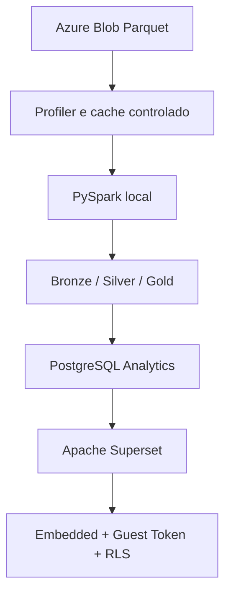

# Arquitetura NeoRetail V8.1 Local

## Responsabilidades

| Componente | Responsabilidade | Nao deve fazer |
| --- | --- | --- |
| Azure Blob | fonte real dos Parquets | regra de visualizacao |
| Blob Profiler | inventario, schema e evidencia | aprovar fato automaticamente |
| PySpark local | Power Query equivalente, uniao de fatos e camadas Bronze/Silver/Gold | inventar KPI |
| Lake local | materializacao tecnica do pipeline | virar fonte corporativa paralela |
| PostgreSQL Analytics | servir `audit.*` e `gold.*` | guardar metadata do Superset |
| PostgreSQL Metadata | guardar objetos internos do Superset | receber dados analiticos |
| Superset | datasets, charts, dashboards e RLS | ser ETL principal |
| Embedded | sessao, tenant, modulos e Guest Token | confiar em tenant da URL |

## Bancos separados

`superset-db` e `analytics-db` usam containers, usuarios, bancos e volumes
distintos. A conexao `NeoRetail Gold - PostgreSQL Local` e cadastrada no
Superset pelo `superset-init`.

## Seguranca

- Segredos ficam somente no `.env`.
- A URL nao escolhe `tenant_id`.
- O backend deriva RLS da sessao autenticada.
- Tabelas fato so chegam a Gold quando possuem `tenant_id`.
- O Superset recebe acesso de leitura ao banco Analytics.

## Migracao futura

PySpark local e as regras de camada podem migrar para Databricks Runtime. O lake
local pode migrar para ADLS/Delta e o PostgreSQL Analytics pode ser substituido
por Databricks SQL. Superset, Embedded, Guest Token e RLS permanecem.
