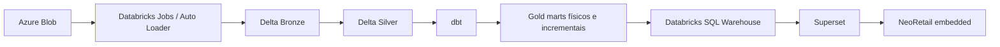

# NeoRetail V9 — histórico da POC e plano de evolução para produto

Atualizado em 10/09/2026. Documento de continuidade para a apresentação de
16/09/2026 e para a transformação da POC em produto.

## 1. Objetivo e estado atual

A POC prova que o NeoRetail pode operar como produto analítico multitenant com:

- Azure Blob como fonte de verdade;
- pipeline local PySpark em Raw cache, Bronze, Silver e Gold;
- PostgreSQL como camada de serving local;
- Apache Superset 6 como camada analítica e de visualização;
- plugin visual próprio para reproduzir os cards e gráficos do Power BI;
- portal NeoRetail embedded, sem expor a navegação administrativa do Superset;
- seleção entre três indústrias autorizadas;
- Guest Token e RLS por `id_customer`;
- quatro dashboards publicados;
- filtros nativos e navegação semelhante ao produto de referência;
- publicação de dashboards do Superset para o portal.

A experiência e a arquitetura estão suficientes para uma POC. A paridade final
das métricas, o desempenho em escala e o acabamento de UX ainda precisam ser
tratados antes de considerar a solução pronta para produção.

## 2. Escopo multitenant validado

| ID | Indústria | Prefixo de origem |
|---:|---|---|
| 259 | 3 Corações | `PARTICULAR_3/3CORACOES` |
| 609 | Baston | `PARTICULAR_3/BASTON` |
| 16868 | Safira | `PARTICULAR_3/SAFIRA` |

O `id_customer` acompanha dimensões e fatos publicados na Gold. No portal, o
usuário escolhe uma indústria permitida e o backend emite um Guest Token com
uma regra como `id_customer = 259`. Essa regra é aplicada pelo Superset antes de
consultar os dados.

O seletor de indústria do portal é parte da segurança e da identidade da
sessão. Um filtro visual do dashboard serve apenas para navegação e não substitui
o RLS.

## 3. Dashboards construídos

### 3.1 Visão geral da indústria

- Slug: `neoretail-v9-visao-geral-industria`.
- Conteúdo: TVD, IVD, giro, OSA, vendas, estoque, ROI e markup.
- Organização em cards semelhante à tela de referência.
- Indicadores MTD, mês anterior e média dos últimos três meses.
- Gráficos de área e barras comparativas.
- Ações de tarefas críticas e itens em risco nos cards aplicáveis.
- Dataset físico atual: `vw_mart_visao_industria`.
- Dataset virtual compartilhado: `nr_overview_history`.

### 3.2 Panorama da indústria

- Slug: `neoretail-v9-panorama-industria`.
- Conteúdo: evolutivos, comparativos, rankings e análises detalhadas.
- Alternância principal por valor.
- Alternância mensal/semanal dentro da visualização, seguindo o comportamento
  esperado do Power BI.
- Seções de estoque, giro/ROI, OSA e falta/excesso.
- Valores adicionados sobre barras e junto aos pontos das linhas.
- Datasets virtuais: `nr_overview_history`, `nr_panorama_weekly`,
  `nr_panorama_latest`, `nr_panorama_opportunities` e
  `nr_panorama_opportunities_latest`.
- Dataset físico atual: `vw_mart_visao_industria`.

### 3.3 OSA Indústria

- Slug: `neoretail-v9-osa-industria`.
- Entrega focada em valor, conforme o escopo definido para a POC.
- Visão geral mensal com venda, OSA e perda.
- Aba `Perdas` usada como equivalente ao bookmark do Power BI.
- Perdas por motivo e por causa.
- Comparativos por região, varejo e hierarquia de item.
- Dataset de filtro principal: `nr_overview_history`.
- Outros datasets virtuais: `nr_osa_industry_causes_259` e
  `nr_panorama_latest`.

### 3.4 Tarefas de otimização de estoque

- Slug: `neoretail-v9-tarefas-otimizacao-estoque`.
- Cards de TVD/pré-ruptura e IVD/excesso.
- Rankings por rede e item.
- Abas de pré-ruptura, excesso e otimização de estoque.
- Tabelas de incidências de excesso e pré-ruptura.
- Filtros de rede, bandeira, UF, cidade, depósito, nível de atividade, marca,
  hierarquias, item e unidade de medida.
- Datasets virtuais: `nr_stock_task_history_259` e `nr_stock_tasks_259`.

## 4. Histórico do feedback e das correções

### Gráficos inicialmente vazios

**Feedback:** os cards exibiam MTD, mês anterior e média U3M, mas a área do
gráfico ficava em branco. Em uma segunda rodada, alguns gráficos funcionavam e
outros continuavam vazios.

**Tratamento:** o plugin `NeoRetail KPI Card` foi integrado ao build do frontend
do Superset e ampliado para renderizar as variantes necessárias: área, barras,
linhas, barras empilhadas, rankings e tabelas. Também foram corrigidas as
consultas e configurações específicas de cada dashboard.

**Situação:** os gráficos são renderizados. A correção visual não representa
certificação das métricas; os números ainda devem ser reconciliados com o Power
BI.

### Falta de valores nos gráficos

**Feedback:** linhas e barras apareciam sem rótulos, dificultando a comparação
com o Power BI.

**Tratamento:** foram incluídos valores sobre as barras e junto aos pontos das
linhas, com formatação de moeda, número e percentual.

**Situação:** concluído visualmente. Ainda é necessário revisar colisões de
rótulos em telas menores e números muito próximos.

### Navegação diferente do Power BI

**Feedback:** Panorama estava dividido em `Valor mensal`, `Valor semanal`,
`Quantidade mensal` e `Quantidade semanal`. O esperado era manter `Valor` como
visão e colocar `Mensal/Semanal` no canto da própria análise. Na tela OSA, a
troca entre visão geral e perdas deveria funcionar como bookmark.

**Tratamento:** a hierarquia de abas foi reorganizada. OSA recebeu as visões
`Valor` e `Perdas`; Panorama passou a usar a alternância mensal/semanal dentro
da estrutura da análise.

**Situação:** adequada para a POC. Quantidade não fez parte do escopo final da
tela OSA.

### Dashboard cortado e barras de rolagem

**Feedback:** o portal mostrava barras de rolagem e o dashboard não cabia na
tela. Depois de ajustes iniciais, gráficos começaram a se alargar e os cards
ficaram separados por grandes espaços, inclusive em outros dashboards.

**Tratamento:** foram removidas regras CSS que forçavam largura e `max-width` da
grade interna do Superset. A grade responsiva voltou a controlar a largura dos
gráficos. As alturas embedded foram configuradas por dashboard.

**Situação:** a grade não deve mais se alargar sozinha. As alturas continuam
configuradas manualmente no catálogo e merecem uma estratégia dinâmica na fase
de produto.

### Filtros ausentes no embedded

**Feedback:** os filtros existiam no Superset, mas não apareciam no portal.

**Causa:** o SDK enviava `standalone=3`. No Superset 6 esse modo é usado para
renderização de relatórios e oculta a barra de filtros, mesmo quando
`filters.visible` está ativo.

**Tratamento:** o parâmetro foi removido. O SDK continua ocultando título, abas
e controles do Superset separadamente e mantém a barra de filtros visível.

**Situação:** filtros analíticos visíveis no embedded. O filtro técnico de
indústria continua removido na publicação porque a indústria já é definida no
portal e protegida por RLS.

### Filtro de indústria no Superset

**Necessidade:** permitir análise manual por indústria dentro do Superset sem
mostrar esse seletor dentro do produto embedded.

**Configuração usada no OSA:** filtro `Indústria`, dataset
`nr_overview_history`, coluna `id_customer`, com escopo para todos os gráficos
compatíveis. O valor padrão `259` deve ser removido quando a intenção for
permitir a seleção das três indústrias.

**Limitação:** o filtro mostra códigos. Para mostrar `3 Corações`, `Baston` e
`Safira`, os datasets devem expor uma coluna de nome da indústria associada ao
`id_customer`.

### Desempenho percebido

**Feedback:** dashboards lentos tanto no portal quanto no próprio Superset.

**Leitura técnica:** como a lentidão também ocorre no Superset, o iframe não é
o principal responsável. Os fatores mais prováveis são:

- vários gráficos disparando consultas independentes;
- datasets virtuais repetindo joins e agregações;
- filtros buscando listas distintas com centenas ou milhares de opções;
- caches frios após reinicialização;
- PostgreSQL, Superset, Redis, Spark e portal disputando recursos no Docker;
- limites de CPU, memória e disco da máquina local;
- falta de marts agregados e de otimização específica para consultas de BI.

Essa hipótese deve ser confirmada medindo `/api/v1/chart/data`, histórico de
consultas e plano de execução SQL. A causa não deve ser atribuída apenas ao
ambiente local sem essas medições.

## 5. Portal embedded construído

O portal em `embedded-app/` reproduz o fluxo principal do NeoRetail:

1. login demonstrativo;
2. tela de soluções;
3. abertura do NeoRetail;
4. escolha entre as três indústrias autorizadas;
5. navegação por Visão geral, Panorama e Tarefas do dia;
6. solicitação de Guest Token específico para dashboard e indústria;
7. renderização do Superset pelo Embedded SDK.

O backend expõe catálogo e token apenas para dashboards autorizados. Testes de
smoke validaram 3 clientes, 4 dashboards, 12 combinações de Guest Token e
rejeição de cliente não autorizado.

## 6. Publicação do Superset para o produto

Foi criado um botão administrativo no próprio Superset:

- `Publicar no NeoRetail` para a primeira publicação;
- `Atualizar no NeoRetail` quando o dashboard já está cadastrado.

A ação:

1. publica o dashboard no Superset;
2. cria ou reutiliza o recurso embedded;
3. configura os domínios permitidos;
4. remove o filtro visual `id_customer`;
5. grava o dashboard no catálogo dinâmico;
6. disponibiliza a nova entrada ao portal sem editar YAML ou reiniciar o
   produto.

O catálogo base permanece em `config/tenants.yaml`. Publicações dinâmicas são
gravadas em `generated/neoretail-published-dashboards.json`.

**Limitação para produção:** o arquivo JSON compartilhado atende à POC local.
Em múltiplas instâncias, o catálogo deve migrar para banco de dados ou storage
compartilhado, com auditoria, versionamento, aprovação, rollback e controle de
concorrência.

## 7. Pipeline de dados

O fluxo atual possui:

- `00`: preparação local;
- `01`: descoberta das fontes no Blob;
- `02A`: dimensões aprovadas na Bronze;
- `02B`: fatos candidatos por família e varejista;
- `03A`: dimensões Silver;
- `03B`: fatos Silver;
- `03C`: oportunidades a partir de `ETL_CALC_V2`;
- `03D`: quality gate Bronze/Silver;
- `04`: aprovação de fatos;
- `05`: dimensões Gold e PostgreSQL;
- `06`: fatos Gold aprovados;
- `07`: prontidão de métricas;
- `08`: quality gate final.

Atualização completa das três indústrias:

```powershell
.\run-multitenant-refresh.ps1
```

Atualização de uma indústria:

```powershell
.\run-multitenant-refresh.ps1 -CustomerIds 259
```

### Retirada de FATO_MERCADO

**Decisão:** `FATO_MERCADO` ficou fora do pipeline da POC.

- `02C` foi removida dos scripts executáveis;
- `IncludeMarket` foi removido do refresh multitenant;
- `03B` não transforma `candidate_mercado_*`;
- `03D` não valida `fact_mercado`;
- o contrato foi marcado como `excluded_from_pipeline`;
- candidatos antigos eventualmente presentes no lake são ignorados.

O notebook `02c_bronze_market.py` e o módulo de mercado permanecem como
referência histórica e não fazem parte do fluxo automático. Executar esse
notebook manualmente ainda pode materializar candidatos Bronze, embora eles não
sigam para Silver ou Gold.

## 8. Dataset físico e dataset virtual

No Superset, um dataset físico aponta diretamente para uma tabela ou view do
banco. Um dataset virtual armazena uma consulta SQL; a consulta costuma ser
usada como subconsulta sempre que um gráfico ou filtro é executado.

Datasets virtuais são úteis para prototipação. Quando vários gráficos reutilizam
joins, janelas e agregações complexas, o custo é pago repetidamente. Para o
produto, as transformações estáveis devem virar marts físicos ou incrementais.

## 9. Candidatos a modelos físicos/dbt

| Prioridade | Dataset atual | Modelo físico sugerido | Motivo |
|---|---|---|---|
| P0 | `nr_overview_history` | `gold.mart_overview_history` | Compartilhado por Visão geral, Panorama e OSA; alimenta gráficos e filtros. |
| P0 | `vw_mart_visao_industria` | `gold.mart_visao_industria` | Base de TVD/IVD e cards principais; deve ser tabela incremental ou materializada. |
| P0 | `nr_stock_task_history_259` | `gold.mart_stock_task_history` | Série temporal dos cards TVD/IVD; remover o sufixo fixo de cliente. |
| P0 | `nr_stock_tasks_259` | `gold.mart_stock_tasks` | Rankings e tabelas detalhadas; provável alto volume e múltiplas agregações. |
| P1 | `nr_panorama_weekly` | `gold.mart_panorama_weekly` | Evita recalcular agrupamentos semanais em cada gráfico. |
| P1 | `nr_panorama_latest` | `gold.mart_panorama_latest` | Centraliza a seleção do último período por indústria. |
| P1 | `nr_panorama_opportunities` | `gold.mart_panorama_opportunities` | Reutilve joins e regras reutilizadas nos rankings. |
| P1 | `nr_panorama_opportunities_latest` | `gold.mart_panorama_opportunities_latest` | Evita repetir lógica de último registro nas análises detalhadas. |
| P1 | `nr_osa_industry_causes_259` | `gold.mart_osa_causes` | Alimenta perdas por motivo e causa; remover dependência nominal do cliente 259. |
| P2 | listas de filtros | `gold.dim_filter_*` ou dimensões enxutas | Reduz `DISTINCT` sobre fatos para Rede, Bandeira, UF, Cidade, Item e hierarquias. |

Antes de materializar, cada modelo precisa declarar:

- grão;
- chave única;
- coluna `id_customer`;
- regra incremental;
- data de atualização;
- fontes e joins;
- política de nulos e duplicidade;
- testes de relacionamento;
- métricas ou dimensões atendidas;
- expectativa de volume e tempo de consulta.

## 10. Arquitetura recomendada com Databricks e dbt



O Databricks tende a melhorar a ingestão e as transformações de grande volume.
Para o dashboard, o ganho depende de SQL Warehouse aquecido, Photon, cache,
clustering, estatísticas e marts preparados para BI. Apenas trocar a conexão do
Superset não garante melhoria.

O dbt deve assumir as transformações analíticas estáveis entre Silver e Gold:

- modelos incrementais;
- marts mensais e semanais;
- testes de unicidade, nulidade e relacionamento;
- documentação e linhagem;
- contratos por coluna;
- padronização de regras de negócio;
- exposição de datasets pequenos e previsíveis ao Superset.

O PySpark ou Databricks continua responsável pela ingestão, schema drift e
processamentos distribuídos. O Superset deve concentrar apresentação,
exploração e agregações leves.

### 10.1 Papel do dbt no produto

O dbt será a camada de transformação analítica entre Silver e Gold. Ele não
substitui a ingestão dos Parquets nem o Superset. Sua responsabilidade será
transformar dados Silver validados em modelos previsíveis e rápidos para BI.

Estrutura inicial sugerida:

```text
dbt/
  models/
    staging/
      stg_fato_historico.sql
      stg_fato_semanal.sql
      stg_fato_ivd_tvd.sql
      stg_calculo_oportunidades.sql
      stg_dim_customer.sql
      stg_dim_local.sql
      stg_dim_item.sql
    intermediate/
      int_overview_history.sql
      int_osa_causes.sql
      int_stock_tasks.sql
      int_opportunities_latest.sql
    marts/
      mart_visao_geral.sql
      mart_panorama_monthly.sql
      mart_panorama_weekly.sql
      mart_osa.sql
      mart_stock_tasks.sql
  tests/
  macros/
  snapshots/
```

Convenções sugeridas:

- `stg_*`: renomeia e tipa colunas vindas da Silver, sem regra de apresentação;
- `int_*`: concentra joins e regras reutilizadas por vários dashboards;
- `mart_*`: entrega o grão final esperado pelo Superset;
- todos os modelos multitenant mantêm `id_customer`;
- métricas certificadas ficam em SQL versionado ou em uma camada semântica
  governada, nunca espalhadas entre gráficos;
- nomes de modelos não devem conter um cliente específico, como `_259`.

Materializações iniciais:

| Camada dbt | Materialização sugerida | Uso |
|---|---|---|
| staging | `view` | transformação leve e padronização de nomes |
| intermediate reutilizado | `incremental` ou `table` | joins e janelas custosos |
| marts de dashboard | `incremental` | consumo interativo pelo Superset |
| dimensões pequenas | `table` | filtros e relacionamentos |
| validações temporárias | `ephemeral` | lógica simples usada por um único modelo |

Testes dbt mínimos:

- `not_null` em `id_customer` e chaves do grão;
- `unique` na chave composta declarada para cada mart;
- `relationships` entre fatos e dimensões;
- `accepted_values` para classificações controladas;
- testes de reconciliação entre Silver e Gold;
- testes singulares para divisor zero, datas futuras e valores negativos
  inesperados;
- testes por indústria para impedir mistura de `id_customer`;
- comparação das métricas certificadas com casos esperados do Power BI.

### 10.2 Ordem de implantação do dbt

1. Criar o projeto dbt apontando para um schema isolado de desenvolvimento.
2. Declarar as fontes Silver e freshness das tabelas.
3. Migrar `nr_overview_history` para o primeiro modelo físico P0.
4. Comparar linha, grão e métricas com o dataset virtual atual.
5. Migrar os marts de tarefas TVD/IVD.
6. Migrar mensal, semanal, OSA e oportunidades.
7. Trocar os datasets do Superset gradualmente para os marts físicos.
8. Medir tempo antes/depois e remover SQL virtual somente após equivalência.
9. Executar `dbt build` no pipeline automatizado antes de liberar dashboards.
10. Gerar e publicar a documentação dbt para linhagem e suporte.

### 10.3 dbt com Databricks

Na arquitetura alvo, o adaptador `dbt-databricks` pode construir os modelos
sobre Delta Lake. Os marts mais usados pelos dashboards devem ser incrementais
e receber otimizações adequadas às colunas de filtro, principalmente
`id_customer`, período, rede, bandeira, UF, local e item.

O fluxo automatizado esperado será:

```text
Ingestão concluída
  → validação Silver
  → dbt deps
  → dbt build
  → testes de reconciliação
  → atualização do serving/SQL Warehouse
  → invalidação controlada de cache
  → dashboards disponíveis
```

Falha em ingestão, testes dbt ou quality gate deve interromper a publicação da
nova versão dos dados.

## 11. Métricas que ainda precisam ser certificadas

A POC reproduz a forma e as expressões disponíveis, mas ainda falta uma rodada
formal de reconciliação com o Power BI. A validação deve cobrir, por indústria e
por período:

| Domínio | Pontos de validação |
|---|---|
| Vendas | sell-out em valor e quantidade, custo, mensal e semanal |
| Estoque | custo e quantidade, fotografia temporal e fechamento do período |
| TVD | definição de pré-ruptura, unidade, criticidade e tendência |
| IVD | definição de excesso, unidade, criticidade e tendência |
| OSA | numerador, denominador, perda em reais, motivo e causa |
| Giro | fórmula, janela temporal e classificação por nível de atividade |
| ROI | fórmula, filtros e tratamento de divisor zero |
| Markup | base de custo, venda, percentual e período |
| U3M | meses incluídos, média simples/ponderada e meses incompletos |
| MTD | data de corte, último movimento e comparação com mês anterior |

Para cada métrica, guardar:

1. definição de negócio aprovada;
2. DAX ou Power Query de referência;
3. SQL/dbt equivalente;
4. conjunto pequeno de casos esperados;
5. resultado Power BI e resultado NeoRetail;
6. tolerância aceita;
7. responsável pela aprovação;
8. data e versão da certificação.

## 12. Automação futura

Um GitHub Actions pode disparar o pipeline manualmente ou por agenda. O ambiente
atual escreve em PostgreSQL e volumes Docker locais, portanto um runner hospedado
pelo GitHub não consegue atualizar diretamente a máquina do desenvolvedor.

Opções:

1. **Runner self-hosted:** executa os scripts atuais em uma máquina ou VM com
   Docker e acesso ao Azure.
2. **Databricks Jobs:** GitHub Actions autentica no Azure por OIDC, dispara um
   job, acompanha o resultado e falha se o quality gate reprovar.
3. **Orquestrador corporativo:** agenda ingestão, dbt e testes dentro da própria
   plataforma de dados; GitHub fica responsável por CI/CD do código.

Para produção, evitar credenciais SAS permanentes no GitHub. Preferir identidade
federada/OIDC, Key Vault ou identidade gerenciada.

## 13. Pendências e riscos antes da produção

### Dados e métricas

- reconciliar todas as métricas com o Power BI;
- confirmar grãos e chaves de negócio;
- medir cobertura e qualidade por indústria;
- tratar meses incompletos e datas sem movimento;
- confirmar que nenhuma fórmula aproximada permaneceu.

### Desempenho

- medir tempo por `/api/v1/chart/data`;
- capturar SQL e plano de execução dos gráficos mais lentos;
- materializar datasets P0;
- criar agregações mensais e semanais;
- avaliar índices no PostgreSQL durante a transição;
- testar Databricks SQL com warehouse frio e aquecido;
- estabelecer orçamento de desempenho por dashboard.

### Produto e UX

- revisar responsividade em resoluções menores;
- substituir alturas embedded fixas por ajuste baseado no conteúdo;
- revisar colisões de rótulos;
- criar loading, timeout e mensagens de erro consistentes;
- definir fluxo oficial de publicação, aprovação e rollback;
- integrar autenticação corporativa;
- substituir usuário demonstrativo por identidade real;
- registrar auditoria de troca de indústria e acesso a dashboards.

### Segurança e operação

- manter RLS por `id_customer` como barreira obrigatória;
- testar acesso cruzado em CI;
- mover catálogo dinâmico para storage persistente;
- rotacionar secrets e não versionar `.env`;
- configurar observabilidade, logs, métricas e alertas;
- definir backup do metadata database do Superset;
- definir estratégia de versionamento dos dashboards.

## 14. Critérios sugeridos para sair de POC

- métricas prioritárias reconciliadas e aprovadas;
- consultas P0 dentro do tempo de resposta acordado;
- pipeline incremental automatizado;
- quality gates bloqueando publicação inválida;
- autenticação corporativa e RLS testados;
- catálogo de dashboards persistente e auditável;
- deploy reproduzível em ambiente não local;
- monitoramento e rollback disponíveis;
- teste com usuários das três indústrias;
- aceite de UX e negócio registrado.

## 15. Evidências técnicas e versionamento

Principais marcos já registrados no Git:

| Commit | Entrega |
|---|---|
| `617f693` | base da POC multitenant NeoRetail/Superset |
| `4b95f57` | dashboards NeoRetail no Superset |
| `54b8121` | README completo do projeto |
| `cdb0f2a` | dashboard de otimização de estoque |
| `3ef1020` | filtro de indústria nas tarefas |
| `db2fe43` | portal embedded multitenant |
| `ca32a68` | ajustes dos dashboards no portal |
| `a2578eb` | correção da grade responsiva |
| `08cabcf` | publicação do Superset para o produto |
| `ab26d6e` | exibição dos filtros no embedded |
| `edb6975` | retirada de FATO_MERCADO do pipeline |

No momento desta atualização, os três últimos commits estão apenas na branch
local `feat/neoretail-dashboards`; o remoto está em `a2578eb`. A PR existente
precisa receber esses commits quando houver autorização explícita para o push.

Existem duas alterações locais do usuário, preservadas fora dos commits:

- `local-engine/notebooks/02b_bronze_fact_candidates.py`: `INVENTORY_ONLY=False`;
- `local-engine/notebooks/02c_bronze_market.py`: `INVENTORY_ONLY=False`.

A segunda alteração permite executar mercado manualmente pelo notebook, apesar
de `FATO_MERCADO` estar excluída do pipeline automático.

## 16. Validações executadas

- build completo do frontend customizado do Superset;
- presença do botão `Publicar no NeoRetail` no bundle compilado;
- smoke test administrativo e rejeição de sessão anônima na publicação;
- smoke test do portal com 3 clientes, 4 dashboards e 12 Guest Tokens;
- rejeição de indústria não autorizada;
- validação estrutural de clientes, partições, Gold e RLS;
- suíte local com 18 testes após a retirada de `FATO_MERCADO`;
- validação de sintaxe dos scripts PowerShell alterados.

Esses testes validam a estrutura técnica da POC. Eles não substituem a
certificação dos números pelo negócio.

## 17. Implementação da camada física de serving

Em 10/09/2026, os SQLs virtuais usados pelos quatro dashboards foram
substituídos por sete materialized views no PostgreSQL:

| Mart físico | Uso principal |
|---|---|
| `gold.nr_overview_history` | visão geral mensal, panorama mensal e visão OSA |
| `gold.nr_panorama_latest` | comparativos, rankings e detalhamento do último mês por indústria |
| `gold.nr_panorama_weekly` | evolutivos semanais |
| `gold.nr_panorama_opportunities` | TVD/IVD diário, fechamento mensal/semanal e cards de estoque |
| `gold.nr_panorama_opportunities_latest` | rankings de falta e excesso no último movimento |
| `gold.nr_osa_industry_causes` | perdas OSA por motivo e causa |
| `gold.nr_stock_tasks` | rankings e tabelas de tarefas de pré-ruptura e excesso |

Os objetos mantêm `id_customer` no grão e os datasets do Superset continuam
sob RLS. Índices compostos cobrem período, varejo, localização, atividade e
produto dentro de cada indústria. `ANALYZE` é executado ao final do refresh.

Esta implementação entrega a camada física da POC sem adicionar um runtime dbt
ao ambiente local. Cada materialized view corresponde a um futuro modelo dbt;
na migração para Databricks, os mesmos contratos devem virar modelos
incrementais em Delta, executados por `dbt build`. Até essa migração, o arquivo
`analytics-db/marts/30_neoretail_serving_marts.sql` é a fonte versionada das
transformações de serving.

O script `create-superset-kpi-views.ps1` aplica views e marts. O
`run-multitenant-refresh.ps1` já o chama somente depois de terminar a carga dos
três clientes, evitando materializar resultados parciais entre indústrias.

O próximo passo de produto continua sendo migrar esses contratos para um projeto
dbt com `staging`, `intermediate` e `marts`, testes de unicidade/não nulidade,
reconciliação de métricas e documentação de linhagem. No PostgreSQL da POC, a
recriação integral é simples e segura; no Databricks, a materialização incremental
evitará reprocessar todo o histórico a cada execução.
### 17.1 Benchmark local e custo da materialização

No teste controlado com `id_customer = 259`, agregando faturamento e volume por
mês, a consulta física executou em 433,6 ms. A consulta equivalente com os joins
virtuais executou em 1.646,7 ms. Nesse cenário local, o tempo de banco caiu 73,7%
e a consulta ficou aproximadamente 3,8 vezes mais rápida.

As contagens dos cinco conjuntos comparados permaneceram idênticas às fontes.
Os deltas dos totais ficaram entre 10^-10 e 4,6 x 10^-5, causados apenas pela
ordem de soma de colunas `double precision`.

Os sete marts ocupam aproximadamente 4,4 GiB neste snapshot. Esse é o trade-off
da POC: mais disco e alguns minutos no refresh em troca de menor latência
interativa. A recriação ocorre em uma transação; uma falha preserva a camada
anterior, mas consultas concorrentes podem aguardar o lock durante o refresh.
Na arquitetura dbt/Databricks, modelos Delta incrementais devem reduzir tanto o
tempo de atualização quanto o volume reprocessado.