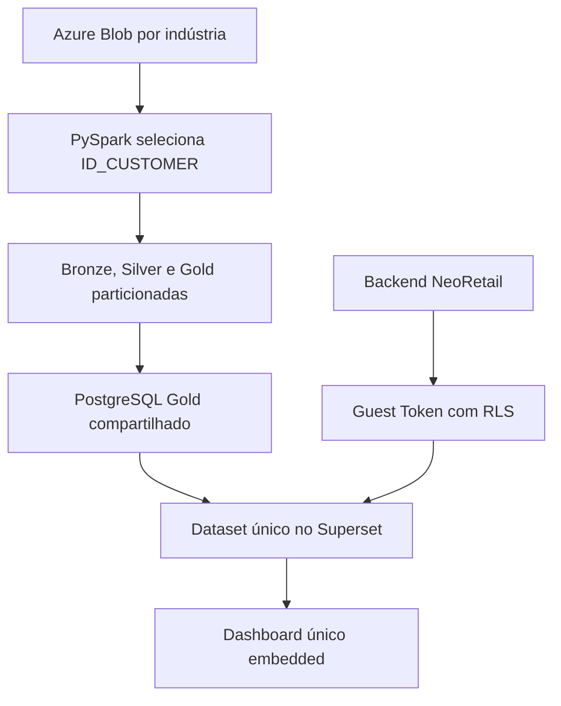
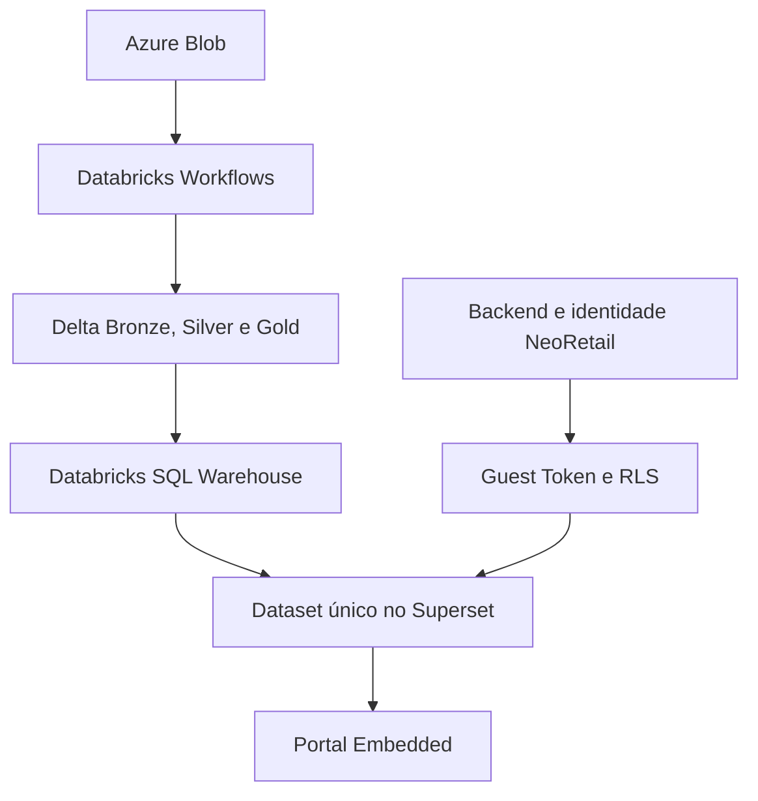

# Arquitetura V9 multi-tenant

## Fluxo da POC local

## Fluxo alvo com Databricks

Na arquitetura final, o Databricks substitui o engine PySpark local e o
PostgreSQL de serving:

O contrato de dados é o mesmo nos dois ambientes: toda dimensão e fato que
chega à Gold possui `id_customer`.

## Como um dashboard atende todos os clientes

1. O usuário autentica no backend NeoRetail.
2. O backend recupera os `id_customer` autorizados para esse usuário.
3. O usuário seleciona uma indústria permitida no portal.
4. O backend valida novamente a seleção e grava o ID na sessão.
5. O backend pede ao Superset um Guest Token para o mesmo dashboard UUID.
6. O token contém, por exemplo, `id_customer = 609`.
7. O Superset aplica essa regra ao dataset antes de calcular `SUM`, `COUNT` ou
   qualquer outra métrica.

Assim, uma soma de TVD nunca mistura 3 Corações, Baston e Safira.

## RLS, filtros e Jinja

| Necessidade | Mecanismo | Segurança? |
|---|---|---|
| Isolar a indústria | Guest Token + RLS `id_customer` | Sim |
| Trocar indústria no portal | Endpoint do backend + novo token | Sim |
| Rede, UF, cidade, loja, marca, item e período | Native Filters do Superset | Não; interação |
| Consultas virtuais complexas com CTE | Jinja, somente se necessário | Não |

O chart não recebe `{{ id_customer }}`. O filtro de segurança vem do token e é
aplicado pelo Superset. Jinja pode ser usado futuramente para otimização de um
dataset virtual específico, mas nunca como fronteira de autorização.

## Modelo físico

- Cadastro: `config/customers.yaml`.
- Lake: `<camada>/<tabela>/id_customer=<ID>`.
- PostgreSQL/Databricks SQL: tabelas compartilhadas com coluna
  `id_customer BIGINT` e índice/cluster nessa coluna.
- Joins: sempre incluem `id_customer` junto com `id_item`, `id_location` ou
  outra chave de negócio.
- Superset: dataset `gold.vw_mart_visao_industria` expõe o ID e os campos usados
  pelos filtros.
